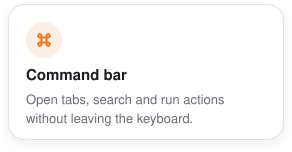
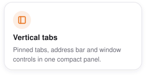
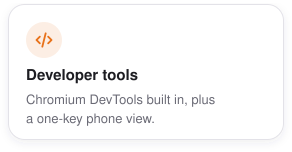
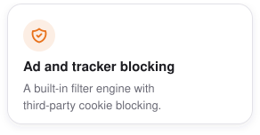
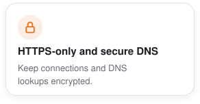
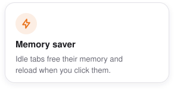

<div align="center">
  <picture>
    <source media="(prefers-color-scheme: dark)" srcset="assets/readme/wordmark-dark.png">
    
  </picture>

  <p>
    <strong>A keyboard-first, privacy-minded Chromium browser for developers.</strong><br>
    Vertical tabs, a fast command bar, built-in ad and tracker blocking,<br>and developer tools without the usual browser chrome.
  </p>

  <p><sub>macOS · <a href="#linux-preview">Linux preview</a> · Open source</sub></p>

  <p>
    <a href="https://yalqen.com/download"><picture><source media="(prefers-color-scheme: dark)" srcset="assets/readme/download-dmg-dark.png"></picture></a>
    <a href="#install"><picture><source media="(prefers-color-scheme: dark)" srcset="assets/readme/install-homebrew-dark.png"></picture></a>
    <br>
    <a href="#macos">macOS installation</a> · <a href="#linux-preview">Build for Linux</a><br>
    <a href="https://github.com/YSamed/yalqen/releases/latest"><picture><source media="(prefers-color-scheme: dark)" srcset="https://ysamed.github.io/yalqen/release-dark.svg"></picture></a>
  </p>

  <p>
    <sub>
      <a href="https://yalqen.com/?utm_source=github&amp;utm_medium=readme">Website</a> ·
      <a href="apps/browser/CHANGELOG.md">Changelog</a> ·
      <a href=".github/CONTRIBUTING.md">Contribute</a> ·
      <a href="README.tr.md">Türkçe</a> ·
      <a href="README.zh-CN.md">简体中文</a>
    </sub>
  </p>
</div>

<p align="center">
  <a href="https://yalqen.com/?utm_source=github&amp;utm_medium=readme"></a>
</p>

## Features

Yalqen is for developers who want Chromium compatibility without a browser UI getting in the way.

<p align="center">
  <picture><source media="(prefers-color-scheme: dark)" srcset="assets/readme/cards/command-dark.svg"></picture>
  <picture><source media="(prefers-color-scheme: dark)" srcset="assets/readme/cards/tabs-dark.svg"></picture>
  <picture><source media="(prefers-color-scheme: dark)" srcset="assets/readme/cards/devtools-dark.svg"></picture>
  <br>
  <picture><source media="(prefers-color-scheme: dark)" srcset="assets/readme/cards/blocking-dark.svg"></picture>
  <picture><source media="(prefers-color-scheme: dark)" srcset="assets/readme/cards/https-dark.svg"></picture>
  <picture><source media="(prefers-color-scheme: dark)" srcset="assets/readme/cards/memory-dark.svg"></picture>
</p>

## Platform support

| Platform | Status | Installation |
| --- | --- | --- |
| macOS 13+ · Apple Silicon | Supported; signed and notarized | [Homebrew or DMG](#macos) |
| Linux | Experimental preview; initially tested on Ubuntu with GNOME Wayland | [Build an AppImage from source](#linux-preview) |
| Windows | Not yet supported | [Help bring Yalqen to Windows](#contribute) |

## Install

### macOS

<picture><source media="(prefers-color-scheme: dark)" srcset="assets/readme/cards/requirements-dark.svg"></picture>

```bash
brew install --cask YSamed/yalqen/yalqen
```

<sub>Prefer a disk image? [Download the latest DMG](https://yalqen.com/download).</sub>

### Linux preview

Build an experimental AppImage from `main` on Linux with **Node.js 24** and Git. Ready-made Linux packages are not yet published.

```bash
git clone https://github.com/YSamed/yalqen.git
cd yalqen/apps/browser
npm ci
npm run package:linux
```

The AppImage is written to `apps/browser/release/`. Make the generated `.AppImage` file executable and open it to run Yalqen. Chromium sandboxing requires working unprivileged user namespaces; Yalqen refuses to start with `--no-sandbox`. Automatic updates are not verified on Linux. For now, rebuild from updated source to update your Linux preview.

[Read the Linux announcement and share your test results](https://github.com/YSamed/yalqen/discussions/280).

## Contribute

Help test Linux on more distributions and desktop environments, report platform-specific issues, or contribute Windows support. Include your distribution, desktop environment, display server (Wayland or X11), and steps to reproduce when reporting a Linux issue.

[Share Linux test results](https://github.com/YSamed/yalqen/discussions/280), [open an issue](https://github.com/YSamed/yalqen/issues/new), or read the [contributing guide](.github/CONTRIBUTING.md). Initial Linux support was contributed by [@Sathyabalan6](https://github.com/Sathyabalan6) in [#208](https://github.com/YSamed/yalqen/pull/208).

<br>

<p align="center"><sub><a href="docs/README.md">Technical details</a> · <a href=".github/CONTRIBUTING.md">Contributing</a> · <a href=".github/SECURITY.md">Security</a> · <a href="LICENSE">MIT License</a></sub></p>

<p align="center"><sub>If Yalqen is useful to you, star the repository. It helps other developers discover the project.</sub></p>
