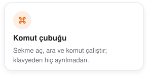
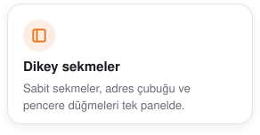
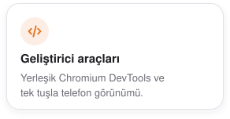
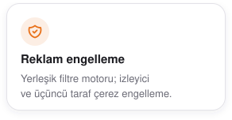
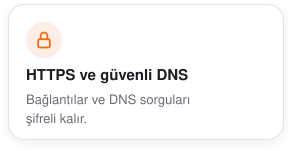

<div align="center">
  <picture>
    <source media="(prefers-color-scheme: dark)" srcset="assets/readme/wordmark-dark.png">
    
  </picture>

  <p>
    <strong><a href="https://yalqen.com/">Yalqen</a> — macOS'ta geliştiriciler için açık kaynaklı, klavye öncelikli Chromium tarayıcısı.</strong><br>
    Dikey sekmeler, hızlı komut çubuğu, yerleşik reklam ve izleyici engelleme<br>ve gereksiz arayüzden arınmış geliştirici araçları.
  </p>

  <p><sub>macOS · <a href="#linux-önizlemesi">Linux önizlemesi</a> · Açık kaynak</sub></p>

  <p>
    <a href="https://yalqen.com/download"><picture><source media="(prefers-color-scheme: dark)" srcset="assets/readme/download-dmg-dark.png"></picture></a>
    <a href="#kurulum"><picture><source media="(prefers-color-scheme: dark)" srcset="assets/readme/install-homebrew-dark.png"></picture></a>
    <br>
    <a href="#macos">macOS kurulumu</a> · <a href="#linux-önizlemesi">Linux için derle</a><br>
    <a href="https://github.com/YSamed/yalqen/releases/latest"><picture><source media="(prefers-color-scheme: dark)" srcset="https://ysamed.github.io/yalqen/release-dark.svg"></picture></a>
  </p>

  <p>
    <sub>
      <a href="https://yalqen.com/?utm_source=github&amp;utm_medium=readme">Web sitesi</a> ·
      <a href="apps/browser/CHANGELOG.md">Değişiklik günlüğü</a> ·
      <a href=".github/CONTRIBUTING.md">Katkıda bulun</a> ·
      <a href="https://github.com/YSamed/yalqen/issues">Hata bildir</a> ·
      <a href="README.md">English</a> ·
      <a href="README.zh-CN.md">简体中文</a>
    </sub>
  </p>
</div>

<p align="center">
  <a href="https://yalqen.com/?utm_source=github&amp;utm_medium=readme"></a>
</p>

## Özellikler

Yalqen, tarayıcı arayüzü yoluna çıkmadan Chromium uyumluluğu isteyen geliştiriciler için.

<p align="center">
  <picture><source media="(prefers-color-scheme: dark)" srcset="assets/readme/cards/command-dark.tr.svg"></picture>
  <picture><source media="(prefers-color-scheme: dark)" srcset="assets/readme/cards/tabs-dark.tr.svg"></picture>
  <picture><source media="(prefers-color-scheme: dark)" srcset="assets/readme/cards/devtools-dark.tr.svg"></picture>
  <br>
  <picture><source media="(prefers-color-scheme: dark)" srcset="assets/readme/cards/blocking-dark.tr.svg"></picture>
  <picture><source media="(prefers-color-scheme: dark)" srcset="assets/readme/cards/https-dark.tr.svg"></picture>
  <picture><source media="(prefers-color-scheme: dark)" srcset="assets/readme/cards/memory-dark.tr.svg"></picture>
</p>

Tüm [klavye kısayollarına](docs/keyboard-shortcuts.tr.md) göz atın. Yalqen ayrıca yedi yerleşik arama motoruyla gelir.

## Platform desteği

| Platform | Durum | Kurulum |
| --- | --- | --- |
| macOS 13+ · Apple Silicon | Destekleniyor; imzalı ve notarize | [Homebrew veya DMG](#macos) |
| Linux | Deneysel önizleme; ilk testler Ubuntu ve GNOME Wayland üzerinde | [Kaynak koddan AppImage derleme](#linux-önizlemesi) |
| Windows | Henüz desteklenmiyor | [Windows desteğine katkıda bulunun](#katkıda-bulunun) |

## Kurulum

### macOS

<picture><source media="(prefers-color-scheme: dark)" srcset="assets/readme/cards/requirements-dark.tr.svg"></picture>

```bash
brew install --cask YSamed/yalqen/yalqen
```

<sub>Disk görüntüsünü mü tercih edersiniz? [Son DMG dosyasını indirin](https://yalqen.com/download).</sub>

### Linux önizlemesi

Linux üzerinde **Node.js 24** ve Git kullanarak `main` dalından deneysel bir AppImage derleyebilirsiniz. Hazır Linux paketleri henüz yayımlanmıyor.

```bash
git clone https://github.com/YSamed/yalqen.git
cd yalqen/apps/browser
npm ci
npm run package:linux
```

AppImage, `apps/browser/release/` klasörüne yazılır. Oluşan `.AppImage` dosyasına çalıştırma izni verip dosyayı açarak Yalqen'i başlatabilirsiniz. Chromium sandbox koruması için ayrıcalıksız kullanıcı ad alanlarının çalışıyor olması gerekir; Yalqen, `--no-sandbox` ile başlatılmayı reddeder. Linux'ta otomatik güncellemeler henüz doğrulanmadı. Şimdilik Linux önizlemesini güncellemek için kaynak kodu güncelleyip yeniden derleyin.

[Linux duyurusunu okuyun ve test sonuçlarınızı paylaşın](https://github.com/YSamed/yalqen/discussions/280).

## Katkıda bulunun

Linux'u farklı dağıtımlarda ve masaüstü ortamlarında test ederek, platforma özgü sorunları bildirerek veya Windows desteğini geliştirerek katkıda bulunabilirsiniz. Linux hata bildirimlerine dağıtımınızı, masaüstü ortamınızı, görüntü sunucunuzu (Wayland veya X11) ve sorunu yeniden oluşturma adımlarını ekleyin.

[Linux test sonuçlarınızı paylaşın](https://github.com/YSamed/yalqen/discussions/280), [bir issue açın](https://github.com/YSamed/yalqen/issues/new) veya [katkı rehberine](.github/CONTRIBUTING.md) göz atın. İlk Linux desteği, [@Sathyabalan6](https://github.com/Sathyabalan6) tarafından [#208](https://github.com/YSamed/yalqen/pull/208) ile eklendi.

<br>

<p align="center"><sub><a href="docs/README.tr.md">Teknik ayrıntılar</a> · <a href=".github/CONTRIBUTING.md">Katkıda bulunma</a> · <a href=".github/SECURITY.md">Güvenlik</a> · <a href="LICENSE">MIT Lisansı</a></sub></p>

<p align="center"><sub>Yalqen işinize yarıyorsa depoya yıldız verin. Projenin başka geliştiricilere ulaşmasına yardımcı olur.</sub></p>
