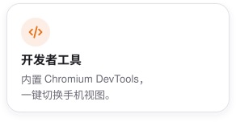
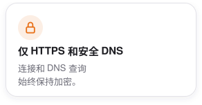
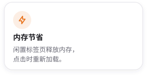

<div align="center">
  <picture>
    <source media="(prefers-color-scheme: dark)" srcset="assets/readme/wordmark-dark.png">
    
  </picture>

  <p>
    <strong>面向开发者、注重隐私的键盘优先 Chromium 浏览器。</strong><br>
    垂直标签页、快速命令栏、内置广告和跟踪器拦截，以及没有多余界面的开发者工具。
  </p>

  <p><sub>macOS · <a href="#linux-预览版">Linux 预览版</a> · 开源</sub></p>

  <p>
    <a href="https://yalqen.com/download"><picture><source media="(prefers-color-scheme: dark)" srcset="assets/readme/download-dmg-dark.png"></picture></a>
    <a href="#安装"><picture><source media="(prefers-color-scheme: dark)" srcset="assets/readme/install-homebrew-dark.png"></picture></a>
    <br>
    <a href="#macos">macOS 安装</a> · <a href="#linux-预览版">构建 Linux 版本</a><br>
    <a href="https://github.com/YSamed/yalqen/releases/latest"><picture><source media="(prefers-color-scheme: dark)" srcset="https://ysamed.github.io/yalqen/release-dark.svg"></picture></a>
  </p>

  <p>
    <sub>
      <a href="https://yalqen.com/?utm_source=github&amp;utm_medium=readme">官网</a> ·
      <a href="apps/browser/CHANGELOG.md">更新日志</a> ·
      <a href=".github/CONTRIBUTING.md">参与贡献</a> ·
      <a href="README.md">English</a> ·
      <a href="README.tr.md">Türkçe</a>
    </sub>
  </p>
</div>

<p align="center">
  <a href="https://yalqen.com/?utm_source=github&amp;utm_medium=readme"></a>
</p>

## 功能

Yalqen 适合想要 Chromium 兼容性、又不想被浏览器界面干扰的开发者。

<p align="center">
  <picture><source media="(prefers-color-scheme: dark)" srcset="assets/readme/cards/command-dark.zh-CN.svg"></picture>
  <picture><source media="(prefers-color-scheme: dark)" srcset="assets/readme/cards/tabs-dark.zh-CN.svg"></picture>
  <picture><source media="(prefers-color-scheme: dark)" srcset="assets/readme/cards/devtools-dark.zh-CN.svg"></picture>
  <br>
  <picture><source media="(prefers-color-scheme: dark)" srcset="assets/readme/cards/blocking-dark.zh-CN.svg"></picture>
  <picture><source media="(prefers-color-scheme: dark)" srcset="assets/readme/cards/https-dark.zh-CN.svg"></picture>
  <picture><source media="(prefers-color-scheme: dark)" srcset="assets/readme/cards/memory-dark.zh-CN.svg"></picture>
</p>

查看全部[键盘快捷键](docs/keyboard-shortcuts.md)。Yalqen 还内置了七个搜索引擎。

## 平台支持

| 平台 | 状态 | 安装方式 |
| --- | --- | --- |
| macOS 13+ · Apple Silicon | 已支持；已签名并公证 | [Homebrew 或 DMG](#macos) |
| Linux | 实验性预览；已在 Ubuntu 和 GNOME Wayland 上进行初步测试 | [从源码构建 AppImage](#linux-预览版) |
| Windows | 暂不支持 | [参与开发 Windows 支持](#参与贡献) |

## 安装

### macOS

<picture><source media="(prefers-color-scheme: dark)" srcset="assets/readme/cards/requirements-dark.zh-CN.svg"></picture>

```bash
brew install --cask YSamed/yalqen/yalqen
```

<sub>更喜欢磁盘映像？[下载最新 DMG](https://yalqen.com/download)。</sub>

### Linux 预览版

在 Linux 上使用 **Node.js 24** 和 Git，从 `main` 分支构建实验性 AppImage。目前尚不提供预构建的 Linux 安装包。

```bash
git clone https://github.com/YSamed/yalqen.git
cd yalqen/apps/browser
npm ci
npm run package:linux
```

生成的 AppImage 位于 `apps/browser/release/`。为生成的 `.AppImage` 文件添加可执行权限，然后打开它以运行 Yalqen。Chromium 沙箱需要可用的非特权用户命名空间；Yalqen 会拒绝以 `--no-sandbox` 启动。Linux 自动更新尚未验证，目前请更新源码并重新构建以升级 Linux 预览版。

[阅读 Linux 公告并分享测试结果](https://github.com/YSamed/yalqen/discussions/280)。

## 参与贡献

欢迎在更多 Linux 发行版和桌面环境中测试、报告平台特定问题，或参与开发 Windows 支持。报告 Linux 问题时，请提供发行版、桌面环境、显示服务器（Wayland 或 X11）以及复现步骤。

[分享 Linux 测试结果](https://github.com/YSamed/yalqen/discussions/280)、[创建 issue](https://github.com/YSamed/yalqen/issues/new)，或查看[贡献指南](.github/CONTRIBUTING.md)。感谢 [@Sathyabalan6](https://github.com/Sathyabalan6) 在 [#208](https://github.com/YSamed/yalqen/pull/208) 中贡献初步的 Linux 支持。

<br>

<p align="center"><sub><a href="docs/README.zh-CN.md">技术细节</a> · <a href=".github/CONTRIBUTING.md">参与贡献</a> · <a href=".github/SECURITY.md">安全</a> · <a href="LICENSE">MIT 许可证</a></sub></p>

<p align="center"><sub>如果 Yalqen 对你有帮助，欢迎给仓库点个 Star，这能帮助更多开发者发现这个项目。</sub></p>
