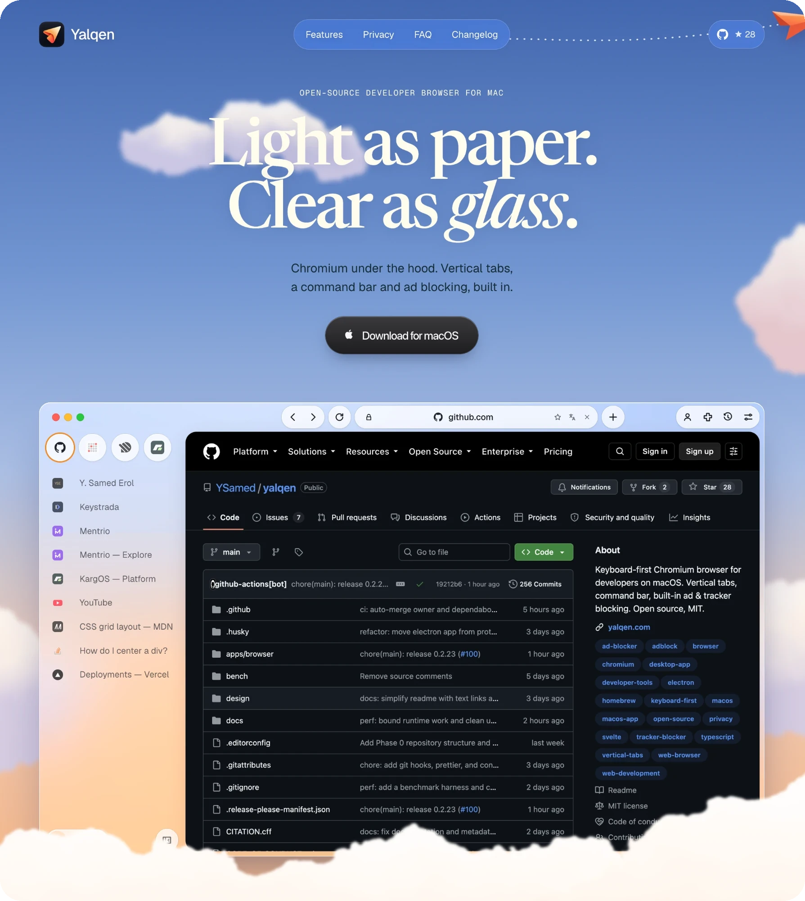

<div align="center">
  <picture>
    <source media="(prefers-color-scheme: dark)" srcset="assets/readme/wordmark-dark.png">
    
  </picture>

  <h1>从想法到屏幕。</h1>
  <p><sub>浏览器、AI 与开发者工具。<br>汇于同一工作空间。</sub></p>

  <p>
    <a href="https://yalqen.com/download"><picture><source media="(prefers-color-scheme: dark)" srcset="assets/readme/download-dmg-dark.png"></picture></a>
    <a href="#homebrew"><picture><source media="(prefers-color-scheme: dark)" srcset="assets/readme/install-homebrew-dark.png"></picture></a>
  </p>
  <p>
    <a href="https://github.com/YSamed/yalqen/releases/latest"><picture><source media="(prefers-color-scheme: dark)" srcset="https://ysamed.github.io/yalqen/release-dark.svg"></picture></a>
  </p>
</div>

<p align="center">
  <a href="https://yalqen.com/"></a>
</p>

<a id="homebrew"></a>

### 也可通过 Homebrew 安装

```bash
brew install --cask YSamed/yalqen/yalqen
```

<a id="linux-预览版"></a>
Linux 预览版: [从源码构建](docs/README.zh-CN.md#linux-预览版). Windows 暂不支持。

---

[键盘快捷键](docs/keyboard-shortcuts.md) · [文档](docs/README.zh-CN.md) · [参与贡献](.github/CONTRIBUTING.md) · [更新日志](apps/browser/CHANGELOG.md) · [MIT 许可证](LICENSE)

<p><a href="README.md">English</a> · <a href="README.tr.md">Türkçe</a></p>
